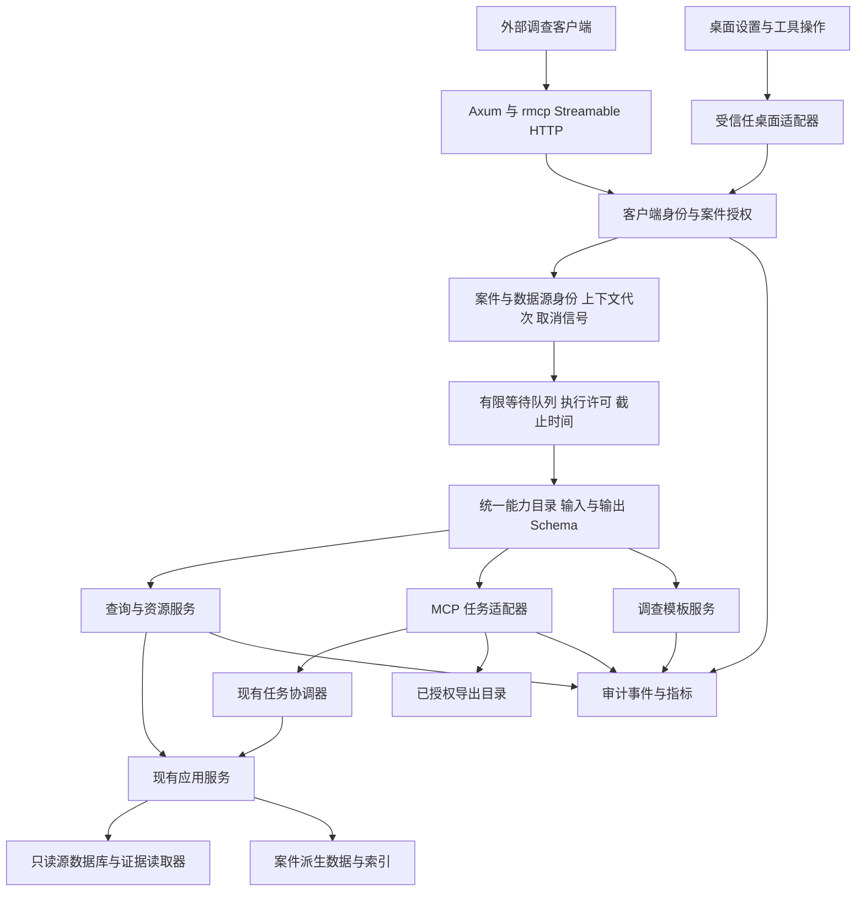

# 内置 MCP 服务端补齐设计

日期：2026-10-26。状态：客户端身份、案件会话绑定、有限队列及案件 SQL 取消已实现。P0 其余项目与后续步骤继续按验收表执行。当前能力以 `docs/mcp-security-model.md` 和代码为准。

## 架构

Rust `rmcp` 负责协议、请求上下文及取消通知；Axum 负责 HTTP 中间件。桌面与 HTTP 共用应用服务、能力目录及权限判定。查询和任务进入统一案件生命周期检查。源数据库与原始证据保持只读，派生数据写入案件工作区，导出写入用户授权目录。

## 当前缺口与目标

| 编号 | 当前证据 | 目标行为 |
|---|---|---|
| G01 | 已移除客户端授权；HTTP 仅接受本机回环来源并绑定当前案件会话，默认允许全部客户端读取 | 来源限制、案件会话绑定和工具开关 |
| G02 | 客户端默认可读取全部数据源，支持限制数据源；外部文件提取使用受控目录 | 逐项核查读取权限和数据源范围 |
| G03 | 入队前记录案件与会话，执行前复核；旧会话和排队期间的案件切换均拒绝 | 查询游标继续绑定案件代次 |
| G04 | 两个执行、16 个等待、每外部主体四个等待；案件及源数据库 SQL、锁等待接入取消，拒绝审计另有限额 | 底层证据 I/O 的全程协作取消 |
| G05 | 输入 Schema 与 JSON 结果，输出缺少 Schema | 统一目录生成输入、输出定义及 DTO，严格校验 |
| G06 | 返回摘要，Linux 服务与 Docker 混合在配置数组 | 可分页、过滤的专用查询，保留源文件与记录来源 |
| G07 | 已提供 `list_jobs`、`get_job`、`get_task`、`cancel_job`、`start_analysis`、报告模板、历史和导出任务查询；取消复用案件任务状态机 | 现有分析、索引和导出任务的创建、状态、结果及取消 |
| G08 | 已提供 tools、Resources、ResourceTemplates 和 Prompts | 资源模板与调查 Prompt 遵守主体权限 |
| G09 | 工具执行、拒绝、取消和超时记录主体与错误码 | Tasks、Resources 和 Prompts 接入审计并验收 |
| G10 | 设置页提供服务开关、工具目录、任务状态、调用统计和当前/峰值 RSS；客户端授权界面已删除 | 完成桌面交互与运行指标验收 |

## 身份和授权

本机部署不使用客户端凭据。HTTP 层只接受 `127.0.0.1` 或 `localhost`，拒绝浏览器 Origin，并绑定当前案件和会话。所有本机客户端默认读取全部数据源，派生任务和导出仍受工具开关与案件生命周期约束。

HTTP 案件主体在进入 rmcp 之前注入请求上下文。桌面调用使用同一案件主体。每个调用记录本机主体和案件会话；请求头和证据正文不进入日志。

| 权限 | 能力 | 授权方式 |
|---|---|---|
| `case:query` | 案件、数据源、统计、分析结果、时间线、搜索、任务状态 | 桌面授予指定案件 |
| `evidence:read` | 文件内容、Registry 值、内容资源 | 桌面单独授予，绑定案件与数据源范围 |
| `derived:run` | 分析与内容索引任务，取消自身任务 | 桌面授予任务种类与数据源范围 |
| `export:write` | 普通文件和报告导出 | 桌面授权具体目录，受期限与操作范围限制 |

全局工具开关与主体权限同时成立才允许调用。授权不会随着桌面切换案件自动转移；客户端需要获得新案件授权。`tools/list` 仅列出该主体有权发现的工具，桌面管理页显示完整目录。工具提示与安全授权分别维护。

数据源读取默认全部开放。导出请求根据 source-scoped `fileId` 在服务端定位数据源所在目录，并写入该目录下受控的 `exports` 子目录；客户端只提交相对文件名和覆盖选项，禁止提交主机绝对路径。使用现有路径验证和原子发布流程，默认拒绝覆盖，操作前重新验证案件身份、数据源身份和目录身份。原始证据目录保持只读。

## 请求生命周期与资源限制

入队时记录 `principalId`、`caseId`、`caseGeneration`、数据源范围、策略版本和请求 ID。取得执行许可后重新验证身份及代次，取得案件访问许可。旧案件请求返回上下文已失效错误，不执行其他案件查询。

默认执行并行数保持两个，等待容量设为 16，每个主体最多占用四个等待位置。容量耗尽立即拒绝；排队上限五秒。普通查询执行上限 30 秒，内容读取上限 60 秒。请求体保持 64 KiB，JSON 结果保持 1 MiB，文件块保持 64 KiB。长任务通过任务接口返回标识，在后台执行。

使用 SDK RequestContext 的取消信号与服务端截止时间派生统一 CancellationToken。SQL 通过 rusqlite 的中断机制取消；分页循环、证据范围读取与结果序列化检查取消信号。执行许可持续到实际执行函数结束；`spawn_blocking` 的 JoinHandle 被释放不能视为执行终止。源读取句柄、案件访问许可与未发布导出文件使用 RAII 清理。

停止服务会停止接收请求、取消等待项和查询，并通知后台任务协调器。导出到达原子发布步骤时按提交结果报告最终状态；取消与完成竞争由现有任务状态机决定，终态仅写入一次。禁止在回复取消后继续发布文件。

## 统一能力目录与错误

每个工具由一个目录条目声明：名称、说明、版本、输入类型、输出类型、所需权限、读写类型、执行类型和限制。使用 `schemars` 从 transport DTO 生成 Schema；业务路由只引用该条目。当前手写目录逐项迁移，现有名称保留，参数变更通过目录版本明确表达。

响应统一包含案件身份、数据源身份、生成时间、内容完整性状态与分页信息。来源引用保留 `fileId`、制品 ID 或时间线事件 ID。缺少数据、平台不支持、提取未运行、索引尚未完成分别返回明确状态。

非法协议方法、未知工具和参数结构错误使用协议错误；领域执行失败使用 `isError=true`，结构化内容包含 `ApiErrorDto` 的 code、category、recoverable 和脱敏详情。成功结果符合 outputSchema。文本兼容内容与 structuredContent 表达同一结果。分页游标绑定查询条件、案件代次和数据源身份，防止跨查询继续读取。

## 专用查询和复用来源

以下为目标能力名称，实施前逐项验证现有服务入口与 DTO；新增服务只完成查询编排，不复制解析代码。

| 能力 | 目标 MCP 接口 | 复用来源 |
|---|---|---|
| 平台能力发现 | `get_capabilities` | 已注册平台能力、提取状态、工具目录 |
| Linux 服务 | `list_linux_services` | Linux system config 派生结果与源数据库分页 |
| Docker | `list_docker_containers`、`list_docker_images` | 已提取配置与镜像元数据 |
| 服务文件预览 | 现有 `read_file` | 列表返回的 source-scoped `fileId` |
| Registry 浏览 | `list_registry_hives`、`list_registry_subkeys`、`list_registry_values`、`read_registry_value_range` | `registry_browser_service` 的只读会话与范围读取 |
| 跨源关系 | `query_graph`、`get_provenance_chain` | `graph_service` 及既有关系投影 |
| 派生任务状态 | `list_jobs`、`get_job` | `job_service`、现有任务记录 |
| 分析与索引 | `start_analysis`、`start_content_index`、`cancel_job` | 现有任务协调器与应用服务 |
| 报告 | `list_report_templates`、`start_report_export` | `app-services/report` 与既有导出流程 |

Linux 查询支持数据源、名称、服务启用状态、记录的运行状态、容器状态和镜像名称过滤，默认 100 条、最多 200 条。服务启用配置、日志中的启动记录、镜像采集时的状态分别保留来源和时间；未知运行状态返回 unknown。使用源数据库查询结果分页，禁止请求时扫描整份镜像。

Registry 使用当前案件与主体绑定的短期会话；读权限不足时禁止创建会话。范围读取有字节限制，案件关闭与授权撤销会回收会话。关系查询只提供类型化条件与数量上限。

分析和索引接口写入派生数据，需要 `derived:run`。任务创建使用客户端提供的幂等键，键绑定主体、案件、操作及参数摘要，重复提交返回同一任务。取消只允许该主体创建的任务或桌面明确授予的任务。

## 任务协议

应用任务 ID 与协议任务 ID 建立映射，持久化状态使用现有任务记录；MCP 层保存主体、案件代次、幂等键和结果引用。进度、状态变更和错误使用统一任务事件。案件关闭按照既有任务清理流程取消派生任务。

支持标准 Tasks 的客户端在协商后使用 `tasks/get`、`tasks/result`、`tasks/cancel`；未协商 Tasks 的客户端调用上述显式任务工具。两种入口使用同一任务记录、取消流程和结果。协议 Tasks 仍属于实验性规范，能力声明与支持的协议版本相互对应。

## Resources 与 Prompts

Resources 提供当前案件概览、数据源能力、索引覆盖率和有权限访问的证据内容。URI 模板为 `forensics://cases/{caseId}/sources/{sourceId}/files/{fileId}`，文件标识进行百分号编码；范围参数使用标准 URI 查询参数。使用成熟 URI 库处理编码和参数，资源读取委托现有文件或摘要查询。文件资源保持 64 KiB 范围上限；响应给出继续读取位置。

客户端需要案件授权才能列举资源。资源 URI 每次读取都重新检查案件代次、主体权限和源身份。缓存键包含这些身份。支持订阅时，通过会话关联的事件发送资源更新；未完成事件通道验收前不声明订阅能力。

Prompts 固定提供案件概览、Linux 服务与 Docker 检查、时间线调查三种调查模板。参数限定为已授权案件、数据源与时间范围。模板只组织调查步骤与资源引用；证据正文作为带来源的数据，不进入模板指令。获取 Prompt 不创建分析或导出任务。

## 模块分布

| 位置 | 责任 |
|---|---|
| `apps/desktop/src-tauri/src/mcp_host/` | HTTP、认证中间件、协议转换、监听与请求上下文 |
| `crates/app-services/src/mcp_host_service/` | 能力目录、主体授权判定、查询编排及结果限制 |
| 现有任务协调器的应用服务接口 | 任务提交、幂等、取消、状态与事件 |
| `crates/transport/src/dto/mcp_host/` | 工具 DTO、配置、主体权限、任务与结果定义 |
| `crates/persistence-sqlite` | 主体授权记录、任务归属和审计查询；具体数据库所有权由现有案件/应用配置边界决定 |
| `frontend/src/features/mcp/` | 设置和运行管理；纯视图与逻辑分别保存 |

配置扩展采用版本化文件与同目录原子替换。认证材料与普通设置分别保存，密钥内容不进入前端全局状态。单文件与函数长度继续遵守仓库限制。

## 执行依赖

| 顺序 | 交付内容 | 进入后续步骤的条件 |
|---|---|---|
| P0 | 身份、权限、案件代次、输出类型、取消与有限队列 | A01–A07 通过 |
| P1 | Linux/Docker、Registry、图关系的查询与来源 | A08–A10 通过 |
| P2 | 长任务、幂等、导出授权和 Tasks 适配 | A11–A14 通过 |
| P3 | Resources、Prompts、管理界面和运行指标 | A15–A18 通过 |

全部步骤属于同一目标架构，执行顺序由权限、生命周期与应用服务依赖决定。

## 验收表

当前执行记录见 `./acceptance.md`。下表按具体场景标记完成程度。

| 编号 | 场景与通过条件 | 验证方法 | 状态 |
|---|---|---|---|
| A01 | 非本机来源、错误主机和无活动案件拒绝；本机客户端默认允许 | 真实 HTTP | 已移除客户端凭据和撤销流程，本机来源与案件检查保留 |
| A02 | 客户端默认可读取全部数据源；证据读取、派生任务和导出分别受权限控制；导出只能写入服务端根据数据源定位的受控 `exports` 子目录 | 真实 HTTP 与界面操作 | 默认全部数据源、证据工具权限和导出权限已修正；完整受限数据源 HTTP 验收待补 |
| A03 | 请求排队期间切换案件，执行中的旧案件请求拒绝；新请求默认读取当前案件；跨源 ID 与旧游标拒绝 | 两个本地案件与真实队列 | 本机客户端默认允许当前案件；运行中的请求保留执行前案件快照，搜索和时间线游标绑定案件、数据源集合和修订；双案件队列验收待执行 |
| A04 | 两个执行、16 个等待、每主体四个等待边界稳定，溢出立即返回 | 实际并发请求与计数 | 通过；桌面共用总等待容量 |
| A05 | SQL、范围读取取消后结束，许可和句柄恢复基线 | 中断真实查询和文件读取 | MCP 执行线程已进入 `ReadScope`，SQL 进度处理器、中断句柄、预览句柄 RAII 和超时取消已接入；真实大文件中断与句柄基线待执行 |
| A06 | 每个工具输入输出通过对应 Schema，非法字段被拒绝，错误分类一致 | 真实 DTO 与协议结果 | 输入 Schema、未知字段拒绝、任务/指标/文件块输出 Schema 和错误分类已验证；其余摘要工具仍使用兼容联合 Schema |
| A07 | 拒绝、执行、超时和取消形成审计，审计无正文与凭据 | 审计数据库查询 | 工具调用审计已有定向验证；Tasks、Resources、Prompts 的协议操作审计待实现和验证 |
| A08 | Linux/Docker 分页无遗漏和重复，服务文件字节等于读取器结果 | 用户指定 E01 与独立来源计数 | Server01 已导入案件的三类查询首 25 条结果与现有分析服务相等；完整分页、服务文件字节和 Server02 验收待执行 |
| A09 | Registry 页面与 MCP 返回相同键值，授权撤销回收会话 | 已导入真实 hive | `browse_registry_key` 已接入现有源绑定浏览服务；真实 hive、多级会话导航和撤销回收验收待执行 |
| A10 | 图关系与页面查询一致，所有节点保留源引用 | 同案件相同查询比较 | `query_graph` 和 `get_provenance_chain` 已接入只读 Graph 服务；真实图数据一致性验收待执行 |
| A11 | 幂等提交只创建一个分析/索引任务；任务结果可追踪到数据源 | 真实任务记录与源数据库 | 客户端幂等请求使用进程内绑定锁和持久化绑定；任务启动与绑定写入尚未组成原子操作，进程中断、跨进程并发和真实任务结果验收待执行 |
| A12 | 取消和完成竞争只产生一个终态，重启可读取最终结果 | 真实任务与进程重启 | 标准 Tasks 取消已传播到底层任务；报告生成器在发布之前仍缺少协作取消，取消与完成竞争及重启验收待实施 |
| A13 | 数据源目录自动定位；输出只能位于受控 `exports` 子目录；过期授权、路径穿越、符号链接、设备路径和覆盖写入均按策略拒绝 | 工作区中的独立数据源目录 | 通过；HTTP 相对导出、越界拒绝和桌面 MCP 主机定向测试通过 |
| A14 | 标准 Tasks 与显式任务工具返回同一任务状态和结果 | 支持与未协商 Tasks 的真实请求 | 已增加主体检查和后台任务状态跟踪；协议任务使用进程内记录，重启恢复、取消终态一致性和真实客户端协商待验证 |
| A15 | 资源发现与读取遵守主体权限，URI 编码和范围读取可继续 | 真实 HTTP 与二进制文件 | 案件概览资源已通过 `get_case_overview` 实际读取并绑定主体案件；文件资源 URI、百分号编码和范围读取待实现 |
| A16 | 三类 Prompt 参数受限，资源引用正确，调用不触发任务 | 真实 prompts/list 与 get | Prompt 已声明参数，校验未知参数、数据源范围和时间长度，并返回案件资源引用；真实协议验收已加入桌面 HTTP 回归 |
| A17 | 管理界面可查看服务、工具、任务和调用状态，素材集中管理 | 桌面交互及前端检查 | 客户端授权界面已删除，设置页保留服务、工具、任务和调用状态 |
| A18 | 查询、文件读取与长任务报告耗时、队列、RSS 与取消延迟；源证据哈希不变 | Release 测量与原证据校验 | 已完成 20 次本机 HTTP 查询烟测，p95=30ms、平均=11ms；完整 Release RSS、取消延迟、直接服务基线和源哈希矩阵待执行 |

性能验收：相同机器、相同已导入案件、相同查询与冷热缓存条件下，鉴权和适配层相对直接应用服务调用的查询 p95 增量不超过 10% 或 10ms 中的较大值；队列容量及并行数严格符合配置。长任务沿用现有资源预算，记录峰值 RSS、处理量与失败结果。任务请求在完成授权和调度后返回任务标识，不等待全量提取。发布文件前的取消必须使发布终止。

### 遗留事项审计

| 优先级 | 问题 | 证据与处理要求 | 关联验收 |
|---|---|---|---|
| 高 | 标准 Tasks 生命周期尚未验收 | 协议任务已检查主体并跟踪后台任务；任务过期、重启和取消终态仍需真实客户端验证 | A14 |
| 高 | 受限授权覆盖不足 | 已限制证据内容、Registry 会话和跨源汇总入口；需要按会话绑定数据源并完成 HTTP 权限验收 | A02、A09、A15 |
| 高 | 幂等创建需要持久化原子协调 | 当前使用进程内锁和案件数据库唯一键，启动和绑定之间的中断、跨进程重复提交与任务恢复仍需修正及验收 | A11 |
| 高 | 报告生成期间无法中断，发布前缺少取消检查 | 生成器内部发布报告并记录历史，需要协调取消、文件发布和任务终态 | A12、A18 |
| 中 | Resources、Prompts 和 Tasks 的协议审计需要扩展失败场景 | 资源、Prompt、Tasks 方法已写入案件审计；拒绝和撤销场景仍需完整协议客户端验收 | A07、A15、A16 |
| 中 | 查询游标、证据读取取消和输出 Schema 不完整 | 分别完成案件与查询绑定、底层读取协作取消及字段级 Schema | A03、A05、A06 |
| 中 | 真实来源和界面验收不完整 | 逐项验证 Linux 分页与来源、Registry、图关系、任务结果和服务工具交互 | A08–A10、A17 |
| 中 | Release 性能矩阵未完成 | 使用同一已导入案件比较直接服务与 HTTP，记录冷热查询、文件读取、长任务、队列、RSS、取消延迟和源文件哈希 | A18 |

## 下一步执行顺序

| 阶段 | 交付内容 | 进入条件 | 验收项 |
|---|---|---|---|
| P0-1 | 统一默认权限：新建授权与旧记录缺省为 `evidence:read`，空数据源列表表示全部数据源；移除界面上的必选读取开关和导出目录输入 | DTO、主体判定和桌面界面合同整理 | A02，已通过 |
| P0-2 | 实现 source-scoped 文件导出定位：由案件数据库解析数据源路径，选择数据源目录下受控 `exports` 子目录，复用现有原子写入和路径安全校验 | P0-1 的权限判定通过 | A13，已通过 |
| P0-3 | 补齐 HTTP、桌面和路径边界验收，更新 `docs/mcp-security-model.md` 与本表 | P0-2 的服务端测试通过 | A01、A02、A07、A13，已通过 |
| P1-1 | 从现有 Linux 派生结果提供服务和 Docker 专用分页查询，返回 source-scoped 服务文件 ID | P0-3 完成 | A08，Server01 首页等价性已通过，完整分页和第二样本待执行 |
| P1-2 | 复用 Registry 浏览服务，先提供 source-scoped 键浏览，再补齐会话导航、值范围读取和撤销回收验证 | P1-1 完成 | A09，基础查询已实现 |
| P1-3 | 复用图查询和来源链，固定分页条件与 sourceObjectId | P1-2 完成 | A10，查询实现已完成，真实图数据验收待执行 |
| P2-1 | 接入现有任务记录的精确状态查询，提供 `list_jobs` 与 `get_job` | P1 查询接口已接入 | A11 的状态查询部分，已完成 |
| P2-2 | 提供 `cancel_job`，复用现有任务状态机和 TaskManager | P2-1 完成 | A12 的取消请求部分，已完成 |
| P2-3 | 提供 `start_content_index`，复用现有证据任务计划、指纹、后台 worker 和持久化幂等绑定 | P2-2 完成 | A11 的内容索引创建与幂等部分 |
| P2-4 | 任务幂等、分析任务创建、报告导出和结果引用 | P2-3 完成 | A11–A13 剩余部分 |
| P3 | Resources、Prompts、管理指标和 Release 性能验收 | P2 通过 | A15–A18 |

P0-1 至 P0-3 已完成并提交，P1-1 查询实现已提交，P1-2 基础 Registry 键浏览已实现，P2-1 至 P2-4 已接入任务状态查询、主体归属取消、内容索引创建、分析任务创建和持久化幂等。下一步补齐结果引用、报告导出与协议 Tasks，随后执行真实样本和发布性能验收；完整 workspace 测试安排在发布验收阶段。

## 技术依据

- [官方 Rust SDK](https://docs.rs/rmcp/latest/rmcp/)：使用现有 Rust SDK 的 server 能力；本仓库当前锁定 `rmcp 3.5.1`，实施以该版本源码为准。
- [MCP Tools](https://modelcontextprotocol.io/specification/2025-11-25/server/tools)：输入输出 Schema、结构化结果与调用错误。
- [MCP Transports](https://modelcontextprotocol.io/specification/2025-11-25/basic/transports)：Streamable HTTP 与请求来源边界。
- [MCP Authorization](https://modelcontextprotocol.io/specification/2025-11-25/basic/authorization)：HTTP 标准授权机制；本设计明确采用本机预配认证的连接限制。
- [MCP Cancellation](https://modelcontextprotocol.io/specification/2025-11-25/basic/utilities/cancellation)：请求取消及资源释放。
- [MCP Tasks](https://modelcontextprotocol.io/specification/2025-11-25/basic/utilities/tasks)：长任务状态、结果与取消，当前规范将其标记为实验性。
- [MCP Resources](https://modelcontextprotocol.io/specification/2025-11-25/server/resources) 与 [Prompts](https://modelcontextprotocol.io/specification/2025-11-25/server/prompts)：资源模板与用户选择的调查模板。
