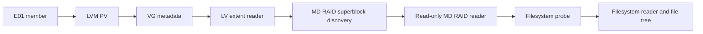

# LV 映射与 MD RAID 读取开发文档

## 1. 文档目的

本文记录 `L:\检材3-服务器` 的只读分析事实，并定义后续 LV 映射与 Linux MD RAID 读取模块的接入边界。本文只描述已经验证的输入、当前代码行为和可执行的开发接口，不把尚未匹配的 RAID 成员写成已完成能力。

## 2. 已验证的检材事实

### 2.1 E01 输入

目录包含两个独立的 E01 文件：

| 文件 | E01 报告容量 | 扇区大小 | 采集软件 |
|---|---:|---:|---|
| `检材3-1.E01` | 60 GiB | 512 字节 | FTK Imager ADI4.7.1.2 |
| `检材3-2.E01` | 60 GiB | 512 字节 | FTK Imager ADI4.7.1.2 |

两个文件均通过 `E01Reader::open`。`ewfinfo` 报告两个文件分别有独立的 MD5/SHA1，当前没有把它们当作 E01 continuation segment。

### 2.2 外层分区

TSK `mmls` 只读结果：

- `检材3-1.E01` 包含两个 Linux LVM 分区。
- `检材3-2.E01` 包含 EFI 分区、Linux swap 分区和两个 Linux LVM 分区。
- 对 LVM 分区直接运行 `fsstat` 返回 `Cannot determine file system type`。这个结果只说明 TSK 没有进入跨 PV LVM 逻辑卷，不能据此判定逻辑卷没有文件系统。

### 2.3 跨 E01 VG/PV

两个 E01 各自只包含同一组 VG 的部分 PV。当前集合导入已经把每个成员的附加 PV 路径传入 LVM 展开器，探测诊断可以同时看到两个 PV。

已经观测到的 VG：

- `root` VG：LV `data`。
- `volum` VG：LV `root`。

`volum/root` 的当前 LV extent map 为：

| LV 逻辑起点 | E01 物理偏移 | 长度 | PV |
|---:|---:|---:|---:|
| `0` | `4201644032` | `29997662208` | `pv0` |
| `29997662208` | `2097152` | `29997662208` | `pv1` |

LV 总长度为 `59995324416` 字节。两段逻辑区间连续覆盖，没有观察到 extent 缺口或超出 PV data area 的情况。

### 2.4 LV 内嵌 MD RAID 证据

在 `volum/root` 的逻辑偏移 `4096` 处发现以下字节：

```text
FC 4E 2B A9 01 00 00 00 00 10 00 00 00 00 00 00
88 0F 20 57 30 E6 4D A6 5B FD B0 6F 70 01 31 BB
6D 61 63 3A 30 00 ...
```

这些字段符合 Linux MD RAID v1 superblock 的布局：

- magic：`0xA92B4EFC`。
- major version：`1`。
- feature map：`4096`。
- 阵列 UUID：`88 0F 20 57 30 E6 4D A6 5B FD B0 6F 70 01 31 BB`。
- 阵列名称：`mac:0`。
- level：`0`，表示 RAID0。
- layout：`1`。
- chunk size：`1024` 个 512 字节扇区，即 512 KiB；解析器必须按 MD v1 规范换算。
- raid disk count：`2`。
- 当前成员编号：`1`。
- data offset：`67584` 个扇区；解析器必须把它转换到 LV reader 的逻辑坐标系。
- superblock offset：`117110784` 个扇区。

同一阵列 UUID 的第二个成员已经在另一个 VG/LV 中确认：

- `root/data`：成员 `dev_number=0`，`data_size=126187520` 个扇区。
- `volum/root`：成员 `dev_number=1`，`data_size=117110784` 个扇区。

两个成员的阵列 UUID、名称、level、layout、chunk、raid_disks 和 roles 一致，但 data size 不同。组装计划必须按最小可用数据范围处理，并将容量差异记录为诊断。当前已经完成成员匹配，尚未完成 RAID reader 组装和重组后文件系统确认。

独立只读分析已经按 RAID0 chunk 规则重组约 1 GiB 逻辑片段，并在重组输出偏移 `0x10000 + 0x40` 发现有效 Btrfs superblock。该 superblock 的关键信息为：

- fsid：`32-31-E5-2F-5E-15-44-C4-B2-24-E2-9C-B4-20-1C-0E`。
- generation：`4389`。
- sectorsize：`4096`。
- nodesize/leafsize：`16384`。
- total bytes：`124568731648`。
- bytes used：`26126225408`。

这证明 `LV → MD RAID0 → Btrfs` 的读取路径具备可行性。当前 Btrfs chunk tree 已支持递归遍历，真实检材的重组 reader 已能打开 Btrfs、枚举 `@rootfs` 子卷、读取 `/etc/passwd`。Btrfs 的 total bytes 大于当前按两个成员 data zone 计算的阵列逻辑容量，仍需继续核对 Btrfs chunk tree 的多设备条带和完整文件范围，不能直接宣称文件树完整可读。

### 2.5 文件系统状态

直接对 LVM LV 读取时，以下主标识均未在 LV 起始位置通过：

- XFS `XFSB`。
- EXT4 `0xEF53`。
- Btrfs `_BHRfS_M`。

因此当前不能创建 XFS/EXT4/Btrfs 文件树。LV 中部出现过 `NTFS`、`LUKS`、`EFI PART`、`XFSB` 等字符串，但它们来自有界数据采样，尚未通过固定位置、geometry、UUID 和 checksum 验证，不能当作文件系统识别结果。

## 3. 当前代码事实

### 3.1 跨成员导入

以下代码已经实现跨 E01 PV 绑定：

- `crates/app-services/src/cluster_service/linux_import/source_binding.rs`
- `crates/app-services/src/cluster_service/linux_import.rs`
- `crates/app-services/src/import_precheck/prepare.rs`
- `crates/app-services/src/import_pipeline/phases/probe.rs`

Linux 证据集合成员获得集合内其他成员的 `LvmDiscoverySource`。普通单数据源导入仍然使用空附加源列表。

### 3.2 LVM reader

当前 `crates/fs-lvm` 已支持：

- LVM2 PV label、PV UUID、data area 和 metadata area 读取。
- VG/LV 文本元数据解析。
- linear 和 striped LV extent map。
- 跨多个 PV 的 `LvReader`。
- 受限 dm-thin 只读读取。
- 物理范围、逻辑范围、依赖深度和循环依赖校验。

当前明确保持失败关闭的 segment：

- RAID0、RAID1、RAID5、RAID6、RAID10。
- cache、snapshot、VDO、writecache。
- 缺失 PV 或不一致 VG。

### 3.3 MD RAID 基础模块

`crates/fs-lvm/src/mdraid.rs` 已新增并通过 `fs-lvm` 定向测试：

- MD v1 superblock 字段解析。
- magic、版本、level、UUID、chunk、成员数量、成员编号和 data range 校验。
- 只读 RAID0 chunk 读取器。
- 缺失成员、成员编号不连续、UUID/chunk/layout 冲突时失败关闭。

应用服务已经在 LVM 展开阶段接入 MD superblock 诊断，能够报告跨 VG/LV 的 `member=0/2` 和 `member=1/2`，并能创建跨 VG/LV 的只读 RAID0 reader。跨设备 Btrfs chunk 的完整读取边界仍需继续验证。

### 3.4 当前能力边界

当前 LVM `direct=true` 只表示 LV 的 LVM segment 可以直接映射到 PV data area，不表示 LV 内容本身就是文件系统。`volum/root` 正是这种情况：LVM 映射成立，LV 内容还包含一层 MD RAID 证据。

## 4. 目标读取链路



每一层都必须保留来源关系：E01 路径、PV UUID、PV 偏移、VG UUID、LV UUID、MD 阵列 UUID、成员编号和文件系统 UUID。

## 5. 接入接口设计

### 5.1 MD 元数据类型

建议新增只读内部类型：

```rust
pub struct MdRaidSuperblock {
    pub major_version: u32,
    pub feature_map: u32,
    pub array_uuid: [u8; 16],
    pub name: String,
    pub level: i32,
    pub layout: u32,
    pub chunk_size: u32,
    pub raid_disks: u32,
    pub data_offset: u64,
    pub super_offset: u64,
    pub recovery_offset: Option<u64>,
    pub dev_number: u32,
    pub device_size: u64,
}
```

解析器必须校验 magic、版本、字段边界、数组 UUID、成员编号和 superblock 所在范围。单独发现 magic 只能产生候选，不能产生可读阵列。

### 5.2 阵列发现

建议对集合内所有可读取 LV 运行有界扫描：

1. 读取 LV 起始区和按 MD metadata 约定的候选位置。
2. 识别 MD v1 superblock。
3. 按 `array_uuid` 分组。
4. 校验 `level`、`raid_disks`、`chunk_size`、`layout` 和成员编号。
5. 拒绝重复成员编号、缺失成员、容量冲突和 UUID 冲突。
6. 生成不可变 `MdArrayPlan`。

建议的计划类型：

```rust
pub struct MdArrayPlan {
    pub array_uuid: [u8; 16],
    pub level: i32,
    pub layout: u32,
    pub chunk_size: u64,
    pub members: Vec<MdArrayMember>,
    pub logical_size: u64,
}

pub struct MdArrayMember {
    pub dev_number: u32,
    pub reader: Box<dyn EvidenceReader>,
    pub data_offset: u64,
    pub device_size: u64,
    pub source_path: PathBuf,
    pub source_kind: DataSourceKind,
    pub lv_identity: LvmLogicalVolumeIdentity,
}
```

### 5.3 RAID0 reader

第一阶段只接入 RAID0：

- `chunk_size` 必须为正数并通过上限检查。
- `raid_disks` 必须等于已绑定成员数量。
- 逻辑偏移按 chunk、条带编号和成员编号计算。
- 读取跨 chunk 范围时拆分为多个底层读取。
- 任何成员缺失、越界或读取失败都返回 typed error。
- 不使用宿主机 device-mapper，不激活系统 LVM，不修改证据源。

RAID0 读取必须提供 `read_at`、`Seek` 和 `EvidenceReader`，使现有 EXT4/XFS/Btrfs reader 可以直接复用。

### 5.4 文件系统探测

MD reader 创建后，按现有顺序运行：

1. XFS superblock 和 allocation group 校验。
2. EXT4 superblock、备用 superblock 和 feature 校验。
3. Btrfs superblock 校验。
4. 其他已支持格式探测。

文件系统候选必须携带 `md_array_uuid` 和成员关系，不能只保存 LV 偏移。

## 6. 失败状态

建议增加以下内部诊断状态：

| 状态 | 含义 |
|---|---|
| `LvMapped` | LVM extent map 通过校验 |
| `MdCandidateFound` | 发现 MD superblock 候选 |
| `MdArrayIncomplete` | 阵列 UUID 已发现，但成员不完整 |
| `MdArrayConflicted` | 成员编号、容量或 UUID 冲突 |
| `MdArrayReady` | 阵列计划通过一致性校验 |
| `FilesystemUnconfirmed` | MD reader 可读，文件系统尚未确认 |
| `FilesystemReady` | 文件系统 reader 通过完整校验 |

当前检材应报告为 `MdCandidateFound`。两个成员已经匹配，向 `MdArrayReady` 推进仍需要验证 data offset、data size、superblock checksum、事件状态和重组读取结果。

## 7. 安全和取证边界

- E01、PV、LV 和 MD reader 都是只读。
- 不调用宿主 `mdadm --assemble`、`vgchange` 或 device-mapper 激活路径。
- 不把物理路径写入前端 DTO；对外只暴露来源 ID、逻辑偏移和脱敏诊断。
- 每次阵列组合都绑定集合 ID、来源 revision 和计划摘要。
- 成员缺失、元数据冲突、未知 RAID level 和 checksum 失败都保持失败关闭。
- 文件系统未确认时不创建文件树，不生成虚假的 inode 或路径。

## 8. 验收条件

### 合成测试

- MD RAID0 两成员、不同 chunk size、跨成员连续读取。
- 成员顺序交换后读取结果保持正确。
- 缺失成员、重复成员、UUID 冲突和容量冲突均失败关闭。
- RAID1 识别为候选但在未实现 reader 前返回 typed unsupported。
- RAID5/6/10 不进入 RAID0 reader。

### 检材回归

- `L:\检材3-服务器` 能发现同一阵列的两个 MD 成员，并报告 data size 差异。
- 两个成员都来自集合内已登记的 LVM LV。
- 重组后的 reader 能通过文件系统 superblock 校验，或明确返回 `FilesystemUnconfirmed`。
- 不把随机字符串命中当作文件系统候选。
- TSK `fsstat`/`fls` 交叉验证只在应用生成的只读逻辑视图上执行。

### 现有质量检查

```powershell
cargo fmt --all -- --check
cargo check -p fs-lvm
cargo test -p fs-lvm
cargo test -p app-services --test linux_e01_integration -- --ignored
powershell -ExecutionPolicy Bypass -File scripts/check-doc-drift.ps1
powershell -ExecutionPolicy Bypass -File scripts/check-doc-archive.ps1
```

当前检材的两个 RAID 成员已经匹配，MD RAID0 基础 reader 已在 `fs-lvm` 中实现；跨 VG/LV 的应用层阵列组装、data size 差异处理和重组后文件系统确认仍未完成。

MD v1 字段布局参考：

- Linux kernel `include/uapi/linux/raid/md_p.h`：<https://raw.githubusercontent.com/torvalds/linux/master/include/uapi/linux/raid/md_p.h>
- Linux kernel RAID administration：<https://www.kernel.org/doc/html/latest/admin-guide/md.html>
